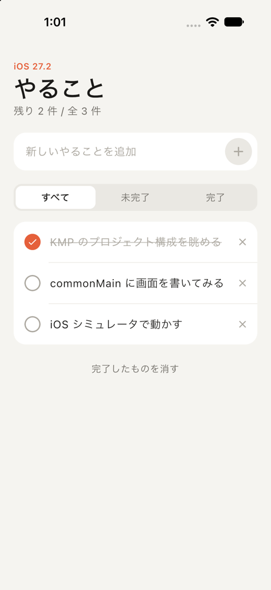
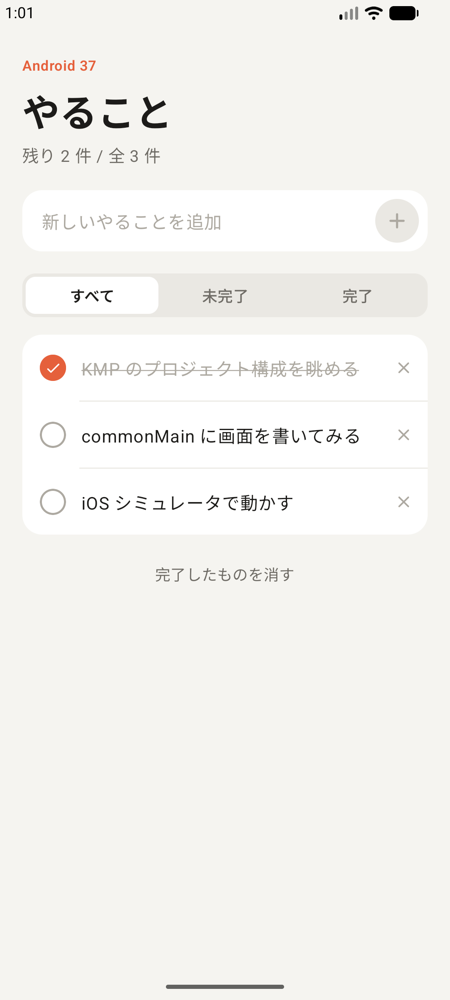

# kmp-study

Kotlin Multiplatform + Compose Multiplatform のサンプル TODO アプリ。
画面・ViewModel・ロジックはすべて `composeApp/src/commonMain` に書かれていて、Android と iOS で同じ UI が動く。

| iOS | Android |
|:---:|:---:|
|  |  |

## 構成

```
composeApp/
  src/commonMain/   共通コード (App, Theme, TodoScreen, TodoViewModel)
  src/androidMain/  Android 固有 (MainActivity, platformName の actual)
  src/iosMain/      iOS 固有 (MainViewController, platformName の actual)
  src/commonTest/   共通テスト
iosApp/
  project.yml       XcodeGen の定義 (iosApp.xcodeproj はここから生成)
  iosApp/           SwiftUI 側。Kotlin の MainViewController() を埋め込むだけ
```

バージョン: Kotlin 2.2.21 / Compose Multiplatform 1.9.3 / AGP 8.13.2 / Gradle 9.1.0
(Xcode 16.3 / 27.2 で動作確認済み)

## 前提

- JDK: Android Studio 同梱のものを使う
  `export JAVA_HOME="/Applications/Android Studio.app/Contents/jbr/Contents/Home"`
- Android SDK: Android Studio の初回セットアップで入れる (`local.properties` の `sdk.dir` は Android Studio が作る)
- Xcode 16.3+、`brew install xcodegen`

## 動かす

Android:

```bash
./gradlew :composeApp:installDebug
```

iOS: `iosApp/iosApp.xcodeproj` を Xcode で開いて Run。
Xcode のビルドフェーズで `./gradlew :composeApp:embedAndSignAppleFrameworkForXcode` が呼ばれ、Kotlin が framework としてリンクされる。
`project.yml` を変えたら `cd iosApp && xcodegen generate`。

テスト:

```bash
./gradlew :composeApp:iosSimulatorArm64Test
```
